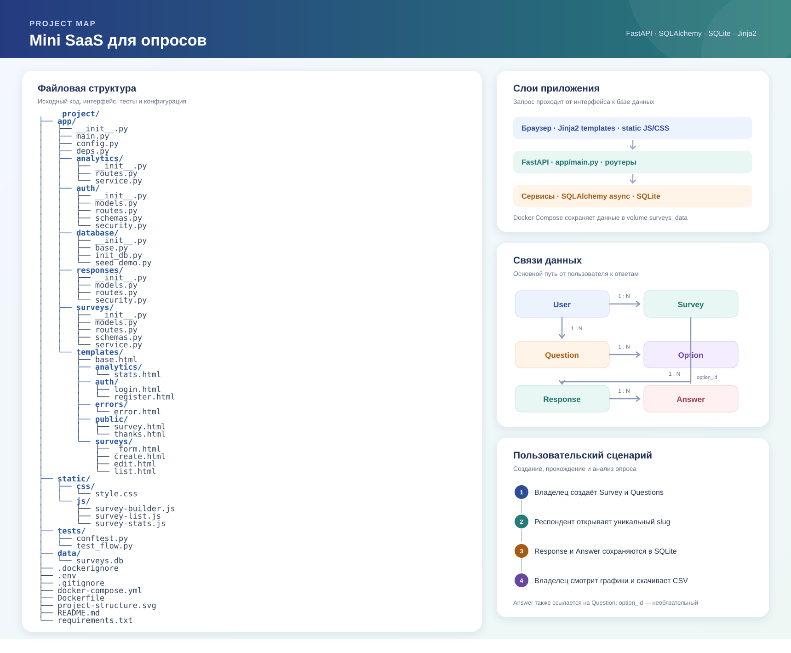

# Mini SaaS для опросов

Проект на FastAPI, SQLAlchemy 2.x (async), SQLite и Jinja2.

## Запуск

Из каталога `project`:

```powershell
python -m venv .venv
.\.venv\Scripts\Activate.ps1
python -m pip install -r requirements.txt
python -m uvicorn app.main:app --reload
```

При запуске приложение создаёт SQLite-базу `data/surveys.db` и необходимые
таблицы. Сервер доступен по адресу <http://127.0.0.1:8000>, документация API —
по адресу <http://127.0.0.1:8000/docs>, проверка состояния — `/health`.

## Запуск в Docker

Требуются Docker и Docker Compose. Из каталога `project`:

```powershell
$env:SECRET_KEY = (python -c "import secrets; print(secrets.token_urlsafe(32))")
docker compose up --build -d
docker compose ps
```

Приложение будет доступно на <http://127.0.0.1:8000>. Проверить состояние
можно командой `docker compose logs web` или через `/health`. SQLite-файл
сохраняется в именованном томе `surveys_data` и переживает пересоздание
контейнера. Для остановки выполните `docker compose down`; для удаления также
данных используйте `docker compose down --volumes`.

Для production задайте собственный постоянный `SECRET_KEY` и не используйте
демонстрационные учётные данные. Секреты не следует добавлять в файлы проекта.

Для другой базы можно задать переменную окружения `DATABASE_URL`, например:

```powershell
$env:DATABASE_URL = "sqlite+aiosqlite:///./data/surveys.db"
```

Для подписи сессий задайте случайный секретный ключ перед запуском. Если
`SECRET_KEY` не задан, приложение создаёт временный ключ при старте, и после
перезапуска все активные сессии станут недействительными:

```powershell
$env:SECRET_KEY = (python -c "import secrets; print(secrets.token_urlsafe(32))")
```

Регистрация доступна по адресу `/auth/register`, вход — `/login`, выход —
POST-запросом на `/auth/logout`. Пароли хэшируются bcrypt; подписанная cookie
сессии имеет флаги `HttpOnly` и `SameSite=Lax` и действует семь дней.
Страницы `/surveys` требуют действительной cookie, а защищённые обработчики
должны дополнительно использовать зависимость `get_current_user`.

## Опросы

После входа откройте `/surveys`, чтобы увидеть свои опросы, создать новый,
отредактировать или удалить его. Конструктор поддерживает вопросы с одним
вариантом ответа, несколькими вариантами и текстовым ответом. Для вопросов
с выбором требуется не менее двух уникальных вариантов.

Формы используют HTML POST; обновление также доступно через PATCH
`/surveys/{id}`. Опросы и вопросы доступны только владельцу. После появления
ответов редактирование вопросов и вариантов блокируется, чтобы сохранить
целостность результатов; название и описание при этом можно изменить.

Опубликованный опрос доступен по ссылке `/survey/{slug}` без входа; ссылку
можно скопировать из списка опросов владельца. Отправка валидируется на сервере,
проверяет допустимые варианты и подписанный CSRF-токен. Одна отправка и все её
ответы сохраняются в SQLite одной транзакцией. После отправки респондент
попадает на страницу подтверждения.

Статистика опроса доступна владельцу по `/surveys/{id}/stats`: общее количество
отправок, распределение вариантов, последние 10 текстовых ответов для каждого
текстового вопроса и 20 последних отправленных анкет. Графики Chart.js дополняют
таблицу значений, которая остаётся доступной и без загрузки библиотеки графиков.
На странице статистики также доступна CSV-выгрузка всех отправок опроса.

## Демо-опрос

Создайте демонстрационный опрос с вопросами разных типов и шестью примерами
ответов:

```powershell
python -m app.database.seed_demo
```

В Docker команда запускается так:

```powershell
docker compose exec web python -m app.database.seed_demo
```

Скрипт безопасно повторно использовать: если демо-опрос уже существует, он
не добавляет повторные ответы. Публичная форма доступна по адресу
<http://127.0.0.1:8000/survey/demo-feedback>. После входа под
`demo@example.com` откройте список опросов и страницу статистики. Пароль по
умолчанию `DemoPassword123!`; задайте свой через `DEMO_PASSWORD` перед запуском
скрипта. Это учебные данные и известная демонстрационная учётная запись —
не используйте их на публичном сервере.

Публичный demo-инстанс пока не развёрнут: ссылка выше предназначена для локально
запущенного приложения. Для публикации проекта укажите URL после выбора и
настройки хостинга.

Ошибки страниц показываются единообразно: для статусов 403, 404 и 422 есть
общая HTML-страница, а ошибки валидации форм дополнительно поясняют, что нужно
исправить. Уведомления об успешном входе и изменениях отображаются в общем
шаблоне.

## Проверки

После установки зависимостей запустите тесты из каталога `project`:

```powershell
python -m pytest
```

Тесты используют отдельную временную SQLite-базу и проверяют основной сценарий
от регистрации до статистики и CSV, а также пустую форму, отсутствие вариантов,
длинные значения и страницы ошибок.

## Структура данных



- `User` владеет опросами (`Survey`).
- `Survey` содержит вопросы (`Question`) и отправленные формы (`Response`).
- `Question` содержит варианты (`Option`).
- `Response` содержит ответы (`Answer`); у ответа может быть выбранный вариант
  или текстовое значение.

SQLite хранит связи с включённой проверкой внешних ключей. Таблицы создаются
асинхронно при старте приложения. Docker Compose хранит базу в постоянном
именованном томе.
